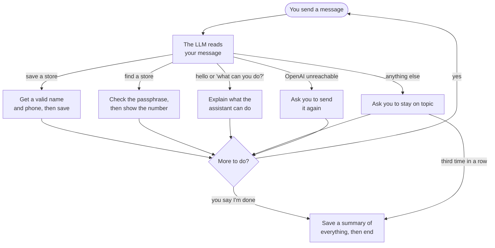
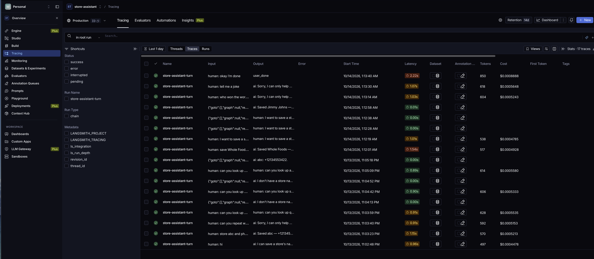

# Store Assistant

A chat assistant that saves stores (name and US phone number) and looks up a saved store's phone
behind a passphrase. You can save and look up as often as you like in one conversation. It ends
when you say you're done, or after three off-topic messages in a row, and a short summary is
saved to the database.

**Stack:** Python 3.14, LangGraph, OpenAI (`gpt-5.4-mini`), SQLite, Streamlit, LangSmith, uv.

## How it works



After each step you can send another message; you can save and look up as many stores as you
like. The summary at the end covers everything you did in the conversation.

- **The LLM does two jobs:** classifying each new message (with structured output) and writing
  the closing summary. Everything else is plain Python: routing, phone validation, the
  passphrase check, cancelling, the off-topic count and all database writes.
- **Questions mid-task** (missing or invalid name or phone, overwrite confirmation, passphrase)
  pause the graph with LangGraph `interrupt()`; your reply goes straight back to the step that
  asked, without the LLM.
- **The passphrase is checked outside the graph.** When the assistant asks for the passphrase,
  the app checks it first and tells the graph only "correct" or "wrong". If you send the
  passphrase as a message on its own at any other time, the app replaces it with
  `[passphrase entered]`. Either way it is never saved or traced. The one exception is a
  passphrase inside a longer sentence, which is treated like any other text.
- **Conversations resume** from the URL (`?thread=<id>`), even after a restart.

The LangGraph graph, design decisions and prompt versioning are in [docs/design.md](docs/design.md).

## Setup

1. Clone the repository and `cd` into it.
2. `cp .env.example .env` and fill in `OPENAI_API_KEY`, `LANGSMITH_API_KEY` and
   `STORE_LOOKUP_PASSPHRASE` (any secret you choose). The template already has every other value.
3. `uv sync` (uv installs Python 3.14 if it is missing).
4. `uv run streamlit run src/store_assistant/ui/app.py`, then open the URL it prints.

If a required variable is missing or blank, the page shows an error naming it when you open it.
Run the app from the repository root so its SQLite files go in `data/`.

## Try it

Type these in one conversation, starting with no `data/` folder (otherwise steps 1 and 2 ask
whether to replace the number already saved):

1. `save Whole Foods, number (555) 234-5678`
2. `I want to save a store`, then `Costco`, then `12345` (asks again), then `(555) 876-5432`
3. `what's the number for Whole Foods?`, then a wrong passphrase, then the right one
4. `I want to save a store`, then `cancel`
5. `who won the world cup?`, then `tell me a joke` (you get a warning)
6. `I'm done` to see the summary

To read saved summaries:

```bash
sqlite3 data/store_assistant.sqlite "SELECT thread_id, end_reason, summary FROM conversation_summaries;"
```

## Tests

```bash
uv run pytest                 # all tests, including real OpenAI calls (billed)
uv run pytest -m "not llm"    # offline tests only, free
uv run ruff check . && uv run ruff format --check . && uv run mypy
```

Tests marked `llm` call OpenAI, so they need real keys and cost money. The offline tests work
with placeholder keys in `.env`; without a real LangSmith key, run them with
`LANGSMITH_TRACING=false` in front. No test uses mocks.

## Tracing

Every turn is traced to LangSmith. To find a conversation:

1. Copy its id from the app's sidebar ("Conversation: <id>").
2. In LangSmith, pick the project named by `LANGSMITH_PROJECT` in the top-left project switcher
   (tests use `store-assistant-tests`), then click **Tracing** in the left sidebar.
3. Widen the time filter (**Last 1 day**) if the conversation is older.
4. Either click **Threads** and open the thread with your id, or stay on **Traces** and, in the
   filter panel under **Metadata**, choose `thread_id` and filter on your id.

Each row is one turn, named `store-assistant-turn`, with its latency, tokens and cost. The
**Input** column shows what you typed (`human: ...`). A turn that answered one of the assistant's
questions shows a resume instead (`{"goto":[],"graph":null,"resume":...}`); it makes no LLM call,
so it has no tokens or cost. For a passphrase answer, the resume holds only
`{"passphrase_ok": true}` or `false`. Click a row to see the graph nodes it ran and any LLM call.



## More

- [docs/design.md](docs/design.md): model vs code, key decisions, requirement-to-test map,
  prompt versioning, limitations and next steps
- [docs/initial_build/spec.md](docs/initial_build/spec.md): the full behaviour spec
- [docs/initial_build/plan.md](docs/initial_build/plan.md): the step-by-step build plan
