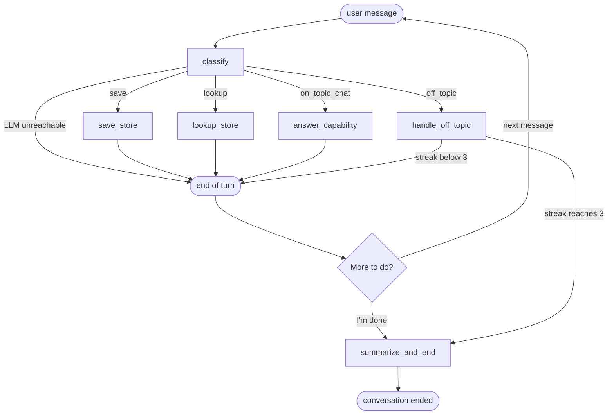

# Store Assistant — Design notes

How the store assistant is put together and why. For setup and running, see the
[README](../README.md); for the original spec and build plan, see
[initial_build/](initial_build/). Code paths are relative to `src/store_assistant/`.

## The graph

This section shows the LangGraph state machine built in `agent/graph.py`. The six graph nodes are
`classify`, `save_store`, `lookup_store`, `answer_capability`, `handle_off_topic` and
`summarize_and_end`; `end of turn` is LangGraph's `END`, and "More to do?" stands for the next
message. A new message enters at `classify`. While a save or lookup waits on a question
(`interrupt()`: store name, phone, overwrite confirmation or passphrase), the answer resumes that
node instead.



Each turn stops at `end of turn`, and the next message starts again at `classify`, so saves and
lookups can repeat in any order. "I'm done" is classified like any other message; its `done`
intent routes to `summarize_and_end`, drawn here from "More to do?" for readability. Every save, update, lookup and cancellation appends an entry to
`actions` in the checkpointed state, and `actions` builds up across turns. `summarize_and_end`
therefore summarises the whole conversation, not only the message that ended it.

## Model vs code

This section shows the split of work between the LLM and plain Python.

The LLM does exactly two jobs:

1. **Intent classification** (`agent/classify.py`): structured output (strict JSON schema over a
   `TypedDict`) returning one of `save`, `lookup`, `done`, `on_topic_chat`, `off_topic`, plus any
   store name and the phone exactly as typed.
2. **The closing summary** (`agent/nodes/summarize.py`): written only from the actions recorded
   across the whole conversation and the end reason, not from the chat transcript.

Everything else is deterministic code, unit-tested without the LLM:

| Concern | Where |
|---|---|
| Routing between nodes | `agent/routing.py` |
| Phone validation (US, stored as E.164) | `validation/phone.py` |
| Store names: trim, normalise, and fall back from "store abc" to "abc" on lookup | `validation/store_name.py`, `storage/stores.py` |
| Passphrase check (constant-time; receives the secret as an argument) | `security/passphrase.py`, called only from `conversation/turns.py` |
| Cancel keywords (`cancel`, `stop`, `never mind`, `nevermind`) and inactivity timing | `conversation/cancellation.py` |
| Yes/no answers to the overwrite question | `agent/answers.py` |
| Off-topic count and the limit of 3 | `agent/state.py` (limit), `agent/routing.py`, `agent/nodes/classify.py`, `agent/nodes/off_topic.py` |
| All database writes | `storage/stores.py`, `storage/summaries.py` |

**Why LangGraph:** the required rules (reprompt, passphrase gate, termination) become graph edges
and plain functions, not instructions the model must follow, and LangGraph supplies `interrupt()`
to pause mid-operation and a checkpointer to persist and resume each conversation.

If an OpenAI call fails (a connection, rate-limit or API error, or a 30-second timeout on each of
the client's three attempts), classification replies "please send that message again" and the
turn ends without changing the off-topic count; the summary falls back to a templated sentence built from the actions.

## Key decisions and trade-offs

This section explains the main design choices; [spec.md](initial_build/spec.md) has the full
rules.

**`interrupt()` for questions mid-operation.** Asking for a missing name, a valid phone, an
overwrite confirmation or the passphrase pauses the node and resumes it with the answer. A resumed
node re-runs from the top, so database writes happen only after the last question. Each pause
carries its own timestamp, which drives the check-in and the cancel (60 and 90 seconds by
default; `STORE_ASSISTANT_CHECK_IN_SECONDS` and `STORE_ASSISTANT_EXPIRE_SECONDS` change them).

**`SqliteSaver` for resumable conversations.** Graph state is checkpointed to
`checkpoints.sqlite` in the data directory (`data/` unless `STORE_ASSISTANT_DATA_DIR` is set),
separate from the app database so it can be wiped without losing
stores. The conversation id is in the page URL (`?thread=<id>`), so a refresh or a server restart
resumes the same conversation.

**The passphrase is checked outside the graph.** It lives only in `.env`. The turn handler checks
what the user typed and resumes the graph with `{"passphrase_ok": true|false}`, so attempts at the
prompt are never in graph state, checkpoints, LangSmith traces (which record graph inputs) or the
database. The traced root run is the graph run itself; the turn handler, which sees the raw text,
is not traced. A message outside the passphrase prompt that is exactly the correct passphrase
becomes `[passphrase entered]` before it reaches the graph. A test fails if any module other than
`config.py` and `conversation/turns.py` reads it, and tests scan every data file (including SQLite
WAL files) for it. Outside the passphrase prompt, the passphrase inside a longer message and wrong
guesses (including near-misses) are ordinary text and are stored and traced. At the passphrase
prompt, "cancel" is checked as a guess; the Cancel button cancels the lookup.

**Ending after three consecutive off-topic messages.** Any on-topic message resets the count, and
a reply to a pending question is taken as its answer, never classified or counted. The
first off-topic reply redirects, the second adds "One more off-topic message and I'll wrap up.",
and the third ends the conversation with `end_reason = off_topic`: the user sees the summary,
which is saved, and the chat becomes read-only ("New conversation" in the sidebar starts over).
Each off-topic message is recorded as an `off_topic_message` action, so the summary mentions
them however the conversation ends.

**US-only phone validation.** Common US formats are accepted and stored as E.164
(`+15552345678`). The area code and the next three digits must start with 2–9, so
`555-123-4567` is rejected. This keeps validation dependency-free and easy to test.

**`gpt-5.4-mini`.** It accepts `temperature=0` and strict JSON-schema output, which keeps the
real-LLM tests stable. `gpt-6-luna` and `gpt-5.6-luna` were checked and rejected because they
refuse `temperature=0` ([spec.md](initial_build/spec.md) §13).

**SQLite rather than a server database.** Two local files, stdlib driver, nothing to install.
The trade-off is single-machine use; see Limitations below.

## Requirements and the tests that prove them

This section says which tests cost money and maps each requirement to its tests.

Tests marked `llm` call the real OpenAI API: they need `OPENAI_API_KEY` and the LangSmith keys
in `.env`, take one to two minutes, and are billed as OpenAI usage on every run. They are
`agent/tests/test_classify.py`, the `agent/tests/test_graph_*.py` files except
`test_graph_llm_unavailable.py`, `conversation/tests/test_turns.py`, and the `ui/tests/*_e2e.py`
files except `test_app_llm_unavailable_e2e.py`. Test traces go to a separate LangSmith project,
`store-assistant-tests`. There is no CI; the pre-commit hook runs the offline checks. No test
uses mocks: tests use real SQLite files in a temporary directory, and outage tests point the
model at a closed local port. Every test reads the six required variables from `.env`; the
offline tests accept placeholder values and make no OpenAI calls, but while
`LANGSMITH_TRACING=true` they still send traces to LangSmith.

| Requirement | Proven by (under `src/store_assistant/`) |
|---|---|
| Save a store by name and phone, confirm success | `agent/tests/test_graph_save.py`, `ui/tests/test_app_e2e.py` |
| Validate the phone and reprompt | `validation/tests/test_phone.py`, `agent/tests/test_graph_save.py::test_missing_details_are_prompted_and_invalid_phone_reprompted` |
| Retrieve a store by name and give its phone | `agent/tests/test_graph_lookup.py` |
| Passphrase gates the lookup | `agent/tests/test_graph_lookup.py`, `security/tests/test_passphrase.py`, `tests/test_passphrase_confinement.py` |
| Many saves and lookups, any order | `ui/tests/test_scenarios_e2e.py::test_save_lookup_miss_and_finish` |
| End on "I'm done" | `agent/tests/test_graph_ending.py::test_saying_done_ends_with_saved_summary` |
| End after repeated off-topic messages | `agent/tests/test_graph_ending.py::test_three_off_topic_messages_end_the_conversation`, `ui/tests/test_scenarios_e2e.py` |
| Concise summary, saved in the database | `agent/tests/test_graph_ending.py::test_summary_states_the_recorded_facts`, `agent/tests/test_graph_ending.py::test_summary_counts_off_topic_messages`, `storage/tests/test_summaries.py` |
| Tracing that allows inspecting past conversations | `agent/tests/test_prompt_trace_metadata.py` (metadata); the LangSmith view itself is checked by hand (README, Tracing) |
| A demo UI | `ui/tests/test_app_e2e.py`, `ui/tests/test_app_threads_e2e.py`, `ui/tests/test_app_inactivity_e2e.py` |

## Prompt versioning

This section explains where prompts live, how their history is kept, and how a trace is tied to
the exact prompt text.

**Where prompts live.** Each prompt is one plain Python module in
`src/store_assistant/agent/llm_prompts/`: `classify_system.py`, `summary_system.py` and
`summary_request.py`, re-exported from the package `__init__.py`. Nodes import them from there.
LLM-bound text also comes from outside the package: `render_summary_request` in
`agent/nodes/summarize.py` inserts a one-line-per-action list and an `END_REASON_TEXT` sentence
into the summary request, and the classifier sees the last six messages, which include the
assistant's fixed replies written in the nodes.

**Version history is git.** Each prompt change is its own commit with a message saying what
changed and why. One prompt's full history, including commits from before it had its own module:

```bash
git log --follow -p -- src/store_assistant/agent/llm_prompts/classify_system.py
```

**Trace linkage.** Every LLM call adds `<name>_prompt_sha` metadata to its LangSmith run: the
first 12 hex characters of the SHA-256 of the prompt text (`classify_system_prompt_sha`, or
`summary_system_prompt_sha` and `summary_request_prompt_sha`, which hashes the template before
the actions are filled in). It is in the `ChatOpenAI` run's Metadata panel. To check which text
produced a trace, hash the current prompt and compare:

```bash
uv run python -c "from store_assistant.agent.llm_prompts import CLASSIFY_SYSTEM_PROMPT, trace_metadata; print(trace_metadata(classify_system=CLASSIFY_SYSTEM_PROMPT))"
```

If it differs, list the hash at every commit that changed the prompt and match it to the trace
(for a summary prompt, swap the file and constant names):

```bash
for c in $(git log --format=%h -- src/store_assistant/agent/llm_prompts/classify_system.py); do printf '%s ' "${c}"; git show "${c}:src/store_assistant/agent/llm_prompts/classify_system.py" | uv run python -c "import sys, hashlib; ns = {}; exec(sys.stdin.read(), ns); print(hashlib.sha256(ns['CLASSIFY_SYSTEM_PROMPT'].encode()).hexdigest()[:12])"; done
```

The hashes cover the prompt modules only; a change to `render_summary_request`, `END_REASON_TEXT`
or the assistant's fixed replies is tracked by git but does not change a hash.

**Regression guard.** `agent/tests/test_classify.py` (marker `llm`) runs the real model against
a table of utterances, including boundary cases such as "thanks, I'm good", and checks that
generic phrases such as "I want to save a store" yield no store name, so a prompt change that
breaks classification fails the suite.
`agent/tests/test_prompt_trace_metadata.py` checks offline that each call carries the right hashes.

**Trade-off.** Version numbers, manifests and lock files were considered and rejected as more
than three prompts need. Git plus content hashes gives exact traceability with nothing to keep in
sync. A prompt registry such as LangSmith's prompt hub becomes worth it with many prompts,
non-engineers editing them, or A/B tests between prompt versions.

## Limitations and next steps

This section lists what is deliberately missing and what would come next.

**Out of scope:** international phone numbers, fuzzy name matching, deleting stores, user
accounts, a list of past conversations, summaries for abandoned conversations, and deployment.

**Known limitations:** the three-attempt passphrase limit is per lookup, so a new lookup resets
it. `AppTest` does not run Streamlit's timed fragment, so the inactivity end-to-end test covers
the check-in and cancel through page reruns, not the one-second timer.

**Next steps with more time:**

1. Lock out lookups for a while after repeated wrong passphrases across lookups.
2. Turn the classifier table into a LangSmith dataset and track accuracy over repeated runs,
   instead of a single pass/fail per utterance.
3. Move both databases to Postgres (`PostgresSaver` for checkpoints) for multi-user deployment.
4. Add international numbers with the `phonenumbers` library and a default region.
